# Skill Tree

<!-- TODO: glossary for iframes -->

Shown below is Waker's skill tree and recommended allocation of skill points among the skills.
The following sections will describe in more detail what each of the skills do.

<figure markdown="span">
    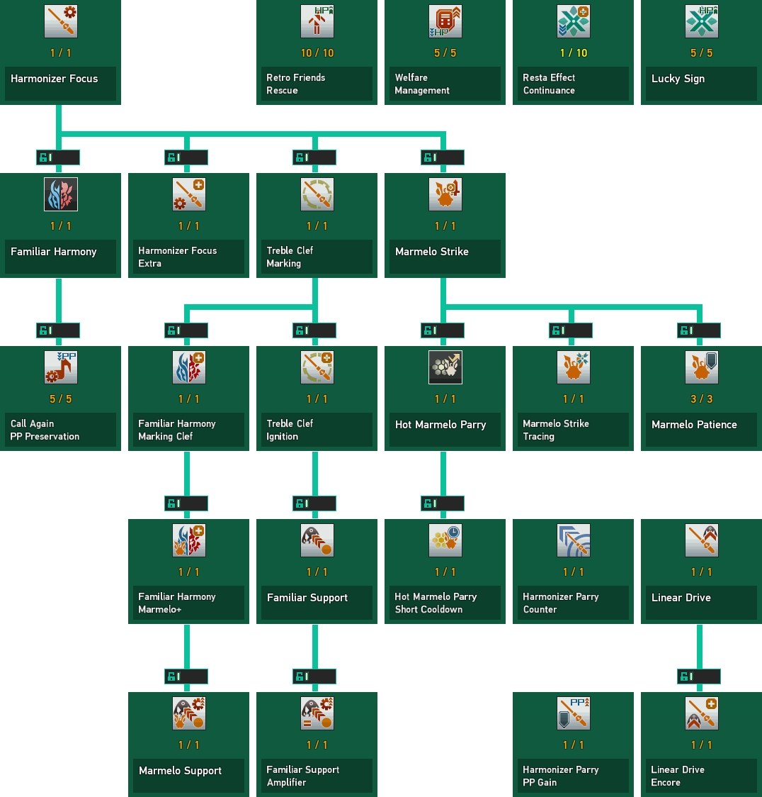
    <figcaption>Waker's skill tree and the recommended allocation of skill points among the skills.</figcaption>
</figure>

## { .twemoji } Harmonizer Focus

=== "{ .twemoji } Harmonizer Focus"

    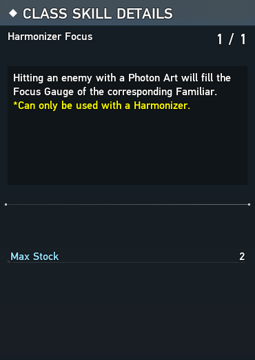{ align=right }

    Unlocks the ability to fill the _Focus Gauges_ of Fredran and Wulfen. 
    Increase each Familiar's Focus Gauge by using their respective [Photon Arts](#photon-arts) or with the help of a
    [Familiar Support](#familiar-support).

    Completely filling one gauge grants a _stock_ for that Familiar.
    Up to 2 stocks of Fredran and Wulfen can be held by default, but this limit is increased to 3 by [Harmonizer Focus Extra](#Harmonizer-Focus-Extra).

    !!! note
        Different types of enemies will fill the Focus Gauges by varying amounts.
        Generally speaking, attacking regular enemies will fill the Focus Gauge much slower than compared to attacking a boss enemy.

=== "{ .twemoji } Harmonizer Focus Extra"

    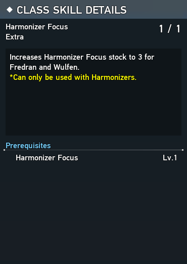{ align=right}

    Increases the maximum number of Harmonizer Focus stocks to 3 for both Fredran and Wulfen.
    Pretty self-explanatory.

<figure markdown="span">
    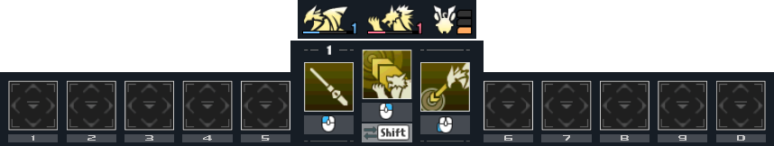{ align=right }
    <figcaption>The Focus Gauges of each Familiar are shown just above the weapon palette in the hotbar. The numbers indicate how many stocks of each familiar you have stored.</figcaption>
</figure>

## { .twemoji } Familiar Harmony 

=== "{ .twemoji } Familiar Harmony"

    

    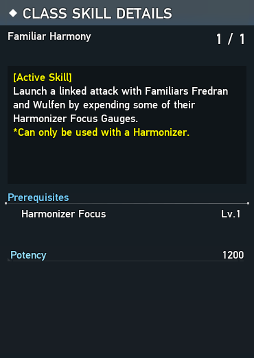{ align=right }

    Unlocks the ability to simultaneously expend one Fredran stock and one Wulfen stock to deal massive damage in a conal AoE in front of you, called a _Familiar Harmony_.
    While performing this attack, you are invulnerable to most forms of damage.
    Additionally, it is a crucial PP management tool, restoring 20 PP for each enemy hit.

    This is your bread and butter skill as a Waker for both resource management and dealing damage.
    It only becomes more useful with additional skills that further enhance its capabilities.
    

    

        <iframe width="560" height="315" src="https://www.youtube.com/embed/MDpuFxnpUXI?playlist=MDpuFxnpUXI&mute=1&loop=1" title="YouTube video player" frameborder="0" allow="accelerometer; autoplay; clipboard-write; encrypted-media; gyroscope; picture-in-picture; web-share" referrerpolicy="strict-origin-when-cross-origin" allowfullscreen></iframe>
    

=== "{ .twemoji } Familiar Harmony Marking Clef"

    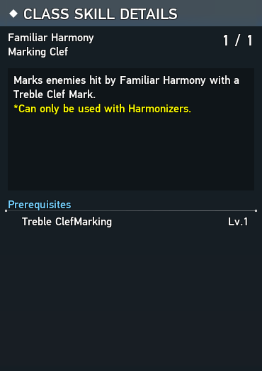{ align=right }

    This skill augments Familiar Harmony to have the additional property of applying a Treble Clef Mark to all enemies it hits,
    which makes simultaneously upkeeping both a [Treble Clef Mark](#treble-clef-marking) and [Familiar Support](#familiar-support) easier to achieve.

    <figure markdown="span">
        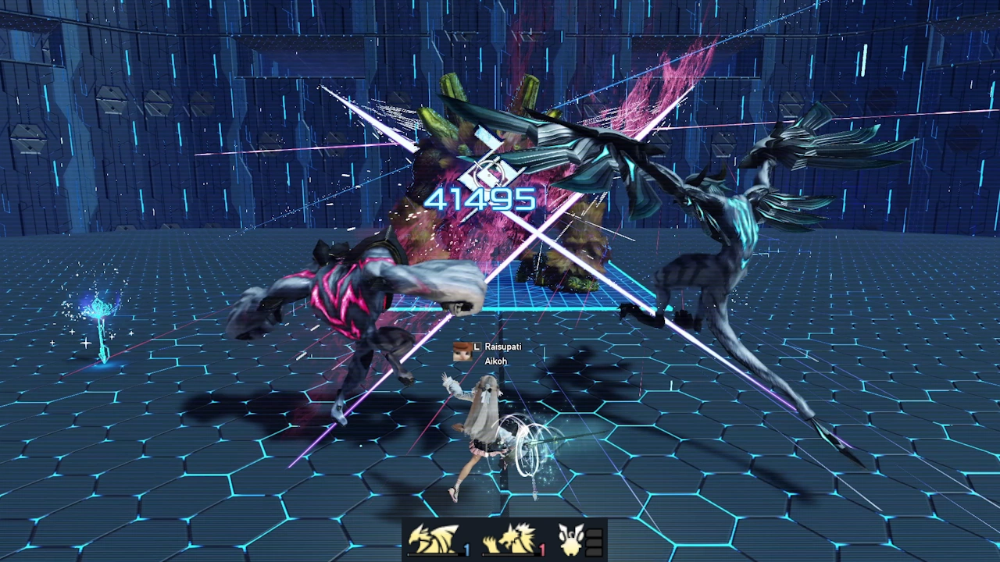
        <figcaption>Familiar Harmony marking a Crag Bear with a Treble Clef Mark</figcaption>
    </figure>

=== "{ .twemoji } Familiar Harmony Marmelo+"

    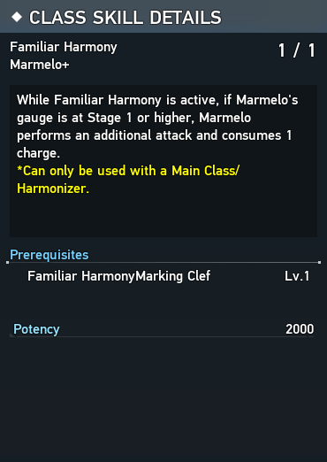{ align=right }

    If [Marmelo's Focus Gauge](#marmelo-strike) is not empty, Familiar Harmony will consume a single Marmelo stock to increase its damage by an additional 66.67%.
    The damage output of a Familiar Harmony Marmelo+ is precisely equal to a thrown stage 3 [Marmelo Strike](#marmelo-strike).
    It also has the extra advantage of being a faster animation than pressing and holding the Weapon Action button to use [Marmelo Strike](#marmelo-strike), while being significantly safer due to the iframes.

    With the [Marmelo Support](#marmelo-support) skill, Familiar Harmony Marmelo+ will also apply a Marmelo Mark.

    <figure markdown="span">
        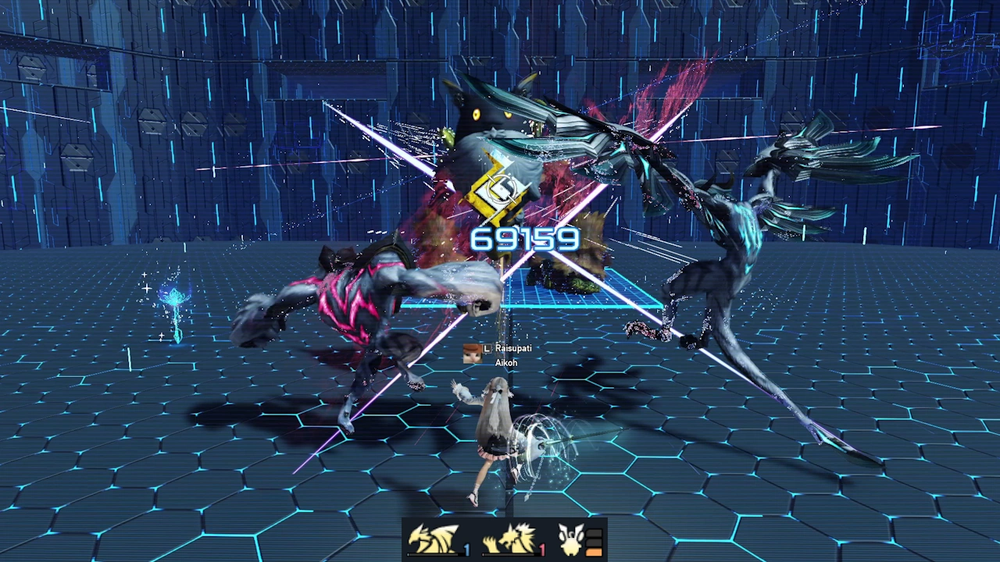
        <figcaption>Familiar Harmony damage boosted by consuming a Marmelo stock</figcaption>
    </figure>

=== "{ .twemoji } Call Again PP Preservation"

    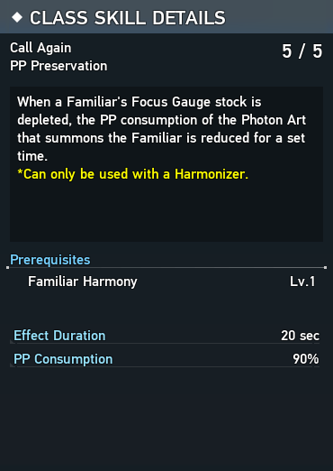{ align=right }

    Reduce PP consumption by 10% on Fredran and Wulfen Photon Arts for 20 seconds after using Familiar Harmony.
    This is a PP management skill that further encourages frequent use of Familiar Harmony.

## { .twemoji } Treble Clef Marking

=== "{ .twemoji } Treble Clef Marking"

    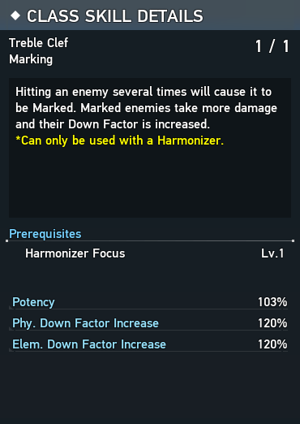{ align=right }

    Hitting the same enemy enough times will accumulate _Treble Clef_ until the enemy becomes afflicted with a _Treble Clef Mark_.
    Marked enemies take 3% increased damage and 20% increased physical and elemental down from Harmonizer [Photon Arts](#photon-arts).
    Different attacks will apply differing amounts of Treble Clef, or possibly none at all.
    A Treble Clef Mark lasts for 30 seconds unless its duration is refreshed by attacking the enemy again, or it is detonated before it expires.

    The Treble Clef Mark becomes even more useful when paired with the [Familiar Support](#familiar-support) skill to enable an additional means of filling Familiar Focus Gauges.

    !!! warning
        The in-game class skill detail description is misleading!
        **The increased damage and Down Factor to marked enemies only applies to your own Harmonizer Photon Arts.**
        Attacks from other players, other weapon types, Photon Blast, Familiar Harmony, Marmelo Strike, Normal Attacks, etc. do not benefit.

=== "{ .twemoji } Treble Clef Ignition"

    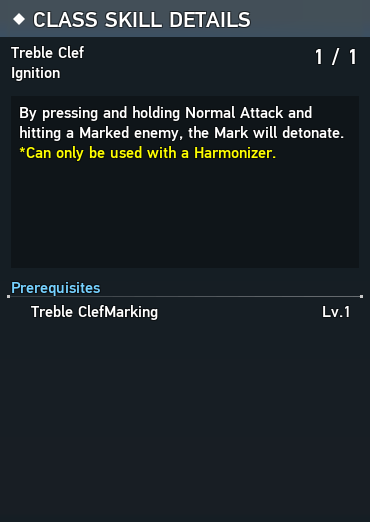{ align=right }

    Treble Clef Ignition enables the detonation of Treble Clef Marks with a long-press Normal Attack or a [long-press Type 2 Fredran Breath](#fredran-breath).

    This skill is not required to detonate enemies afflicted with a Marmelo Mark from the [Marmelo Support](#marmelo-support) skill.

    If an enemy is afflicted by both a Treble Clef Mark and a Marmelo Mark, then both marks will be detonated at the same time.

    !!! warning
        The in-game class skill detail description is misleading.
        This skill simply enables a long-press Normal Attack or long-press Type 2 Fredran Breath to detonate Treble Clef Marks specifically.
        You do not need this skill to be able to perform long-press Normal Attacks or to be able to detonate Marmelo marks from the Marmelo Support skill.
        You do need this skill to be able to detonate marks with Type 2 Fredran Breath.

    <iframe width="560" height="315" src="https://www.youtube.com/embed/Xz7KiDK_F8Y?playlist=Xz7KiDK_F8Y&mute=1&loop=1" title="YouTube video player" frameborder="0" allow="accelerometer; autoplay; clipboard-write; encrypted-media; gyroscope; picture-in-picture; web-share" referrerpolicy="strict-origin-when-cross-origin" allowfullscreen></iframe>

## { .twemoji } Familiar Support

=== "{ .twemoji } Familiar Support"

    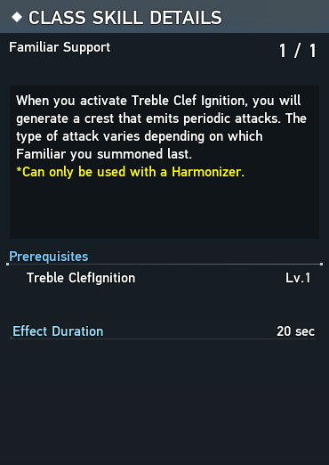{ align=right }

    After detonating a Treble Clef Mark you will generate a crest --- called a _Familiar Support_ --- that periodically inflicts damage to your target by shooting homing projectiles at your current target.
    This damage also contributes to filling the Focus Gauge of Fredran or Wulfen, depending on the type of Familiar Support generated.

    The particular type of Familiar Support generated is determined by the last [Photon Art](#photon-arts) used before detonating a Treble Clef Mark:
    if a Fredran Photon Art was last used, then a blue crest will be generated that can fill Fredran's Focus Gauge; likewise if a Wulfen Photon Art was last used, then a red crest will be generated that can fill Wulfen's Focus Gauge.

    A Familiar Support lasts for 20 seconds unless overwritten by another Familiar Support (which resets the 20 second timer), or you fall in battle (which causes it to disappear immediately).

    <figure markdown="span">
        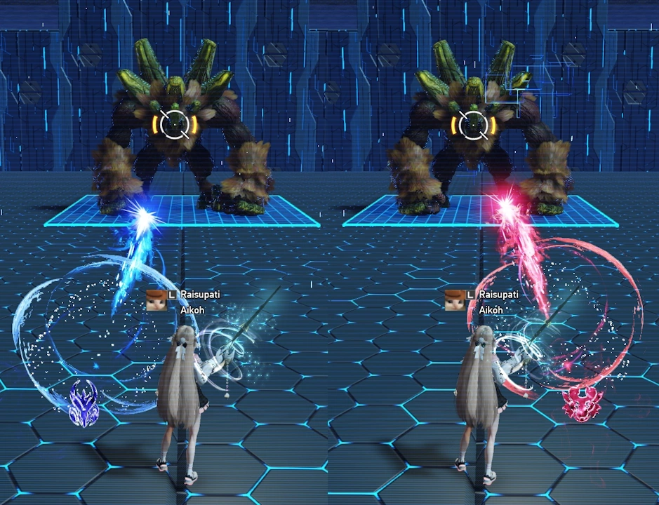
        <figcaption>Fredran Familiar Support left. Wulfen Familiar Support right.</figcaption>
    </figure>

    <!-- _Fredran crest on the left (blue), Wulfen crest on the right (red)._ -->

=== "{ .twemoji } Familiar Support Amplifier"

    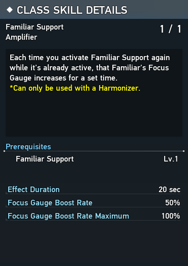{ align=right }

    Each time Familiar Support is activated while one is already active, the amount of Harmonizer Focus the Familiar Support will fill with each attack is amplified.
    Familiar Supports can be amplified up to 2 times, each time boosting its Harmonizer Focus Gauge rate by 50% up to a maximum of 100%.
    You can visually tell that a Familiar Support is amplified based on how purple-shaded it is.

    A Familiar Support will retain its amplification level until it expires, then the next activated Familiar Support will no longer amplified.
    Therefore, it is essential to reactivate Familiar Support every 20 seconds to ensure that the Familiar Support does not expire.

    !!! tip
        The Familiar Support amplification level is shared between the Fredran and Wulfen Familiar Supports.
        Hence, you are not required to repeatedly activate the same Familiar Support to benefit from Familiar Support Amplifier.

    !!! warning
        The in-game class skill detail description is misleading!
        The Focus Gauge Boost Rate from Familiar Support Amplifier only applies to the Familiar Support itself.
        The Focus Gauge Boost Rate does not apply to anything else.

    <figure markdown="span">
        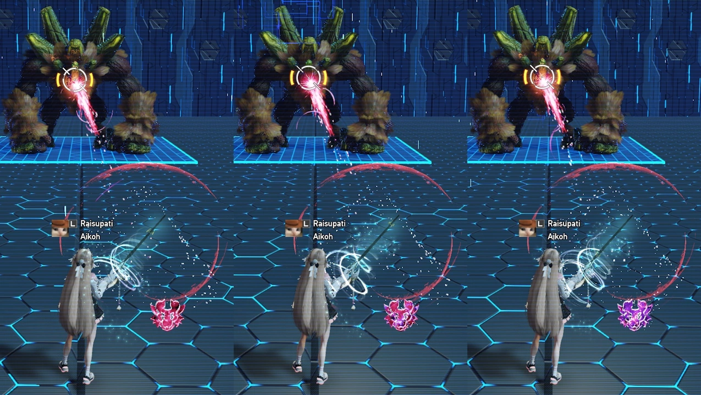
        <figcaption>Wulfen Familiar Support increasingly amplified from left to right.</figcaption>
    </figure>

## { .twemoji } Marmelo Strike

=== "{ .twemoji } Marmelo Strike"

    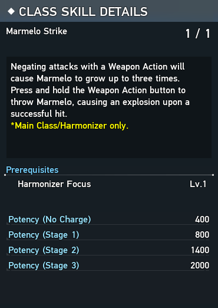{ align=right }

    This skill enables the ability to throw Marmelo by holding and releasing the Harmonizer Weapon Action, and to increase Marmelo's gauge through various actions.
    In the absence of other class skills, the only means of increasing Marmelo's gauge is with the use of the Harmonizer Weapon Action to successfully guard against an incoming attack.
    The class skills [Hot Marmelo Parry](#hot-marmelo-parry) and [Marmelo Patience](#marmelo-patience) are the other two means of increasing Marmelo's gauge.

    Unlike Wulfen and Fredran's Focus Gauges, Marmelo's gauge can only be in one of four distinct _stages_ numbered from 0 to 3.
    In general, the successful use of any action that causes Marmelo to block an incoming attack will increase Marmelo's gauge, and thus its stage, by 1.
    The greater the stage, the greater the damage dealt when Marmelo is thrown at a target, up to a whopping 2000 potency at stage 3.

    In general, it is advisable to only consider throwing Marmelo at stage 3.
    However, there are some cases where a stage 2 Marmelo is worthwhile --- mainly if you would otherwise overcap Marmelo's gauge.

    <figure markdown="span">
        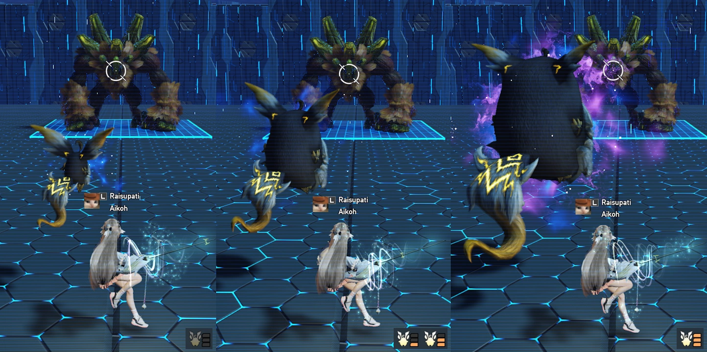
        <figcaption>Marmelo at its four different stages: 0, 1, 2, 3.</figcaption>
    </figure>

=== "{ .twemoji } Marmelo Strike Tracing"

    

    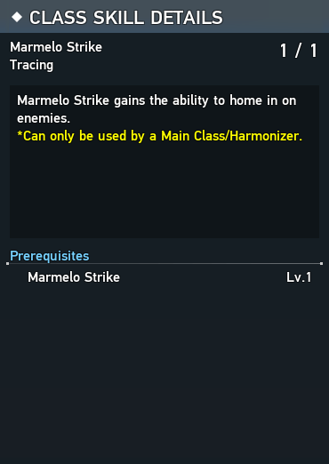{ align=right }

    Allows Marmelo to alter its trajectory mid-flight after being thrown.
    This can helpful for hitting your targets when Marmelo would otherwise miss.
    However, there are still cases where Marmelo can still miss due to its turning radius or the presence of obstacles in the way.
    

    

        <iframe width="560" height="315" src="https://www.youtube.com/embed/0XtM6lccf3U?playlist=0XtM6lccf3U&mute=1&loop=1" title="YouTube video player" frameborder="0" allow="accelerometer; autoplay; clipboard-write; encrypted-media; gyroscope; picture-in-picture; web-share" referrerpolicy="strict-origin-when-cross-origin" allowfullscreen></iframe>
    

=== "{ .twemoji } Marmelo Patience"

    

    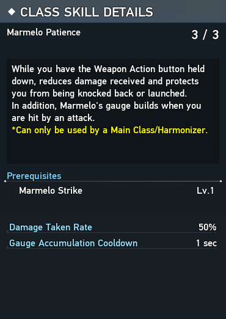{ align=right }

    While you have Marmelo held out by holding the Harmonizer Weapon Action you take 50% reduced damage and are immune to knockbacks and launches.
    Additionally, taking damage from an attack while in this state will increase Marmelo's gauge by 1, with a cooldown of 1 second.

    !!! tip
        Although this skill may seem useless at first glance, it is actually an incredibly useful tool in several different situations:

        - **Unavoidable Damage**: Since the release of Dark Falz Solus, an increasing number of attacks are not able to be avoided by most iframes or guard frames.
        These types of attacks can not be blocked by the Harmonizer Weapon Action or Hot Marmelo Parry, and therefore won't increase Marmelo's gauge.
        However, these unavoidable attacks are still capable of activating Marmelo Patience's ability to increase the Marmelo gauge when damage is taken.

        - **Rapid Multi-hit Attacks**: There are a number of multi-hit attacks that hit too quickly for repeated Harmonizer Weapon Actions to increase Marmelo's gauge by more than one due to end lag of the animation.
        In many cases, rather than repeatedly tapping the Harmonizer Weapon Action, you could tap and hold the Weapon Action to block one attack and then let Marmelo Patience increase Marmelo's gauge once more from getting hit by a following part of the multi-hit attack.
    
        - **Pre-throwing**: Some bosses such as Dark Falz Aegis have brief periods of downtime in which they are not able to be hit, but will deal damage in the moment they become hittable again.
        In cases like this where Marmelo is at stage 2 and the period of downtime is short enough to not warrant using a charged ability like Wulfen Demolition or Type 2 Fredran Riding, you could hold the Harmonizer Weapon Action to prime Marmelo to be ready to throw as soon as the boss becomes hittable.
    

    !!! example
        In this example Marmelo Patience is used at the end of one of Dark Falz Solus' multi-hit attacks to fill the Marmelo gauge to stage 3.
        

            <iframe width="560" height="315" src="https://www.youtube.com/embed/hZB-GMa87jU?playlist=hZB-GMa87jU&mute=1&loop=1" title="YouTube video player" frameborder="0" allow="accelerometer; autoplay; clipboard-write; encrypted-media; gyroscope; picture-in-picture; web-share" referrerpolicy="strict-origin-when-cross-origin" allowfullscreen></iframe>
        

## { .twemoji } Marmelo Support

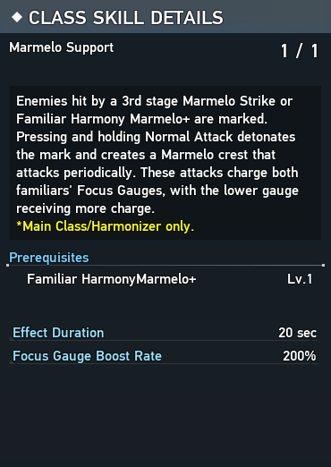{ align=right }

Marmelo Support is a skill that essentially provides a Marmelo-specific version of a Treble Clef Mark and Familiar Support, but with a few major differences.

Marmelo Support enables 3rd stage Marmelo Strike and Familiar Harmony Marmelo+ to apply a special mark --- which will be referred to as a _Marmelo Mark_.
A Marmelo Mark has the same properties as a Treble Clef Mark: the same 20 second duration, the same methods of detonation, and the same damage dealt upon being detonated.
However, upon detonating a Marmelo Mark, a Marmelo crest will be created instead of a Familiar Support crest.
There are a few notable differences between a Marmelo crest and a Familiar Support crest:

- A Marmelo crest can simultaneously coexist alongside a Familiar Support crest
- A Marmelo crest does not benefit from Familiar Support Amplifier
- The projectiles from a Marmelo crest apply Treble Clef per hit. By itself, 10 hits will mark an enemy with a Treble Clef Mark
- A Marmelo crest fills the Focus Gauges of both Fredran and Wulfen simultaneously, with the lower of the two receiving double the amount of Focus Gauge filled

    <iframe width="560" height="315" src="https://www.youtube.com/embed/sPgUfCci6qI?playlist=sPgUfCci6qI&mute=1&loop=1" title="YouTube video player" frameborder="0" allow="accelerometer; autoplay; clipboard-write; encrypted-media; gyroscope; picture-in-picture; web-share" referrerpolicy="strict-origin-when-cross-origin" allowfullscreen></iframe>

## { .twemoji } Hot Marmelo Parry

=== "{ .twemoji } Hot Marmelo Parry"

    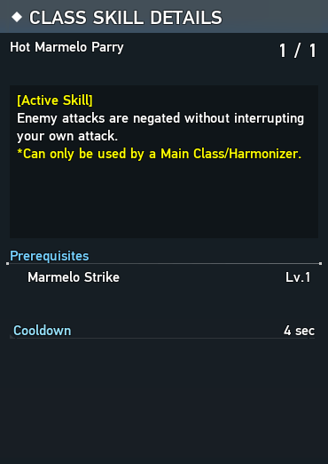{ align=right }

    Hot Marmelo Parry is an active skill with a 4 second cooldown that you can activate at _any_ time to have Marmelo guard an attack for you.
    If Hot Marmelo Parry successfully guards an attack, it increases Marmelo's gauge by one.

    !!! warning
        Although Hot Marmelo Parry does not interrupt your own attacks, it does have _hitstop_ which momentarily slows your actions when Marmelo guards an attack, and can interrupt _transitions_ between tapped and held variants of certain actions such as the Harmonizer Weapon Action into Marmelo Strike or the transition between the tapped and held variants of [Photon Arts](#photon-arts).
        Hot Marmelo Parry **also grants a period of invulnerability** after it guards an attack, which will cause you to be unable to use the Harmonizer Weapon Action to block attacks (and increase Marmelo's gauge) for a short while afterwards.

=== "{ .twemoji } Hot Marmelo Parry Short Cooldown"

    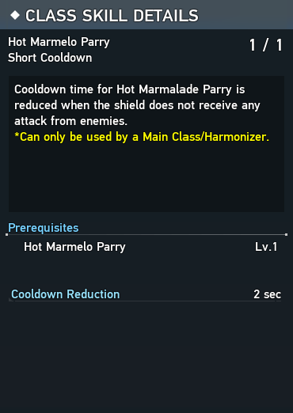{ align=right }

    If Hot Marmelo Parry did not guard an attack, its cooldown is reduced by 2 seconds. 
    It is good to have in case you use Hot Marmelo Parry preemptively or dodged an attack you thought would have hit.

    <iframe width="560" height="315" src="https://www.youtube.com/embed/vULVYtvyWvg?playlist=vULVYtvyWvg&mute=1&loop=1" title="YouTube video player" frameborder="0" allow="accelerometer; autoplay; clipboard-write; encrypted-media; gyroscope; picture-in-picture; web-share" referrerpolicy="strict-origin-when-cross-origin" allowfullscreen></iframe>

## { .twemoji } Harmonizer Parry

=== "{ .twemoji } Harmonizer Parry Counter"

    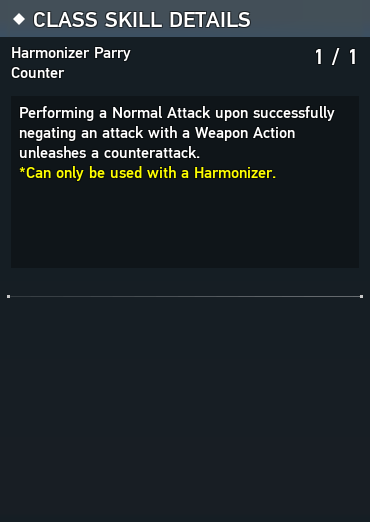{ align=right }

    Performing a Normal Attack after successfully guarding an attack with the Weapon Action unleashes a strong counter attack.
    Can not be performed after a successful guard with [Marmelo Patience](#marmelo-patience) or [Hot Marmelo Parry](#hot-marmelo-parry).

=== "{ .twemoji } Harmonizer Parry PP Gain"

    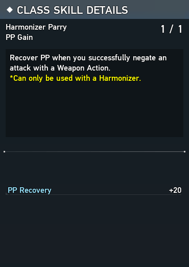{ align=right }

    Gain 20 PP when you successfully guard with the Weapon Action.
    Does not apply to [Hot Marmelo Parry](#hot-marmelo-parry) or [Marmelo Patience](#marmelo-patience).

    <iframe width="560" height="315" src="https://www.youtube.com/embed/R_hEnK27GF8?playlist=R_hEnK27GF8&mute=1&loop=1" title="YouTube video player" frameborder="0" allow="accelerometer; autoplay; clipboard-write; encrypted-media; gyroscope; picture-in-picture; web-share" referrerpolicy="strict-origin-when-cross-origin" allowfullscreen></iframe>

## { .twemoji } Linear Drive

=== "{ .twemoji } Linear Drive"

    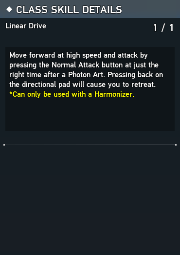{ align=right }

    At a specific time after unleashing a [Photon Art](#photon-arts) (indicated by a flashing purple glow over your character), perform a Normal Attack to unleash an extra attack that moves you toward or away from your target depending on directional movement input.
    Sideways directional movement will perform the forward version of Linear Drive.
    The the backwards version of Linear Drive deals more damage and applys more [Treble Clef](#treble-clef-marking) compared to the forward version.

    This is primarily a movement tool that also deals decent damage almost comparable to a Photon Art when done in quick succession with the use of [Linear Drive Encore](#linear-drive-encore).
    Linear Drive also restores PP, applies a good amount of Treble Clef, and has iframes at the start.

=== "{ .twemoji } Linear Drive Encore"

    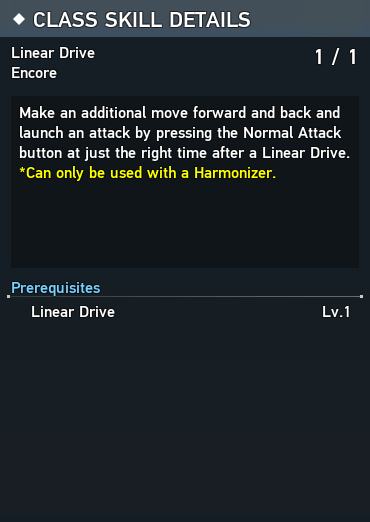{ align=right }

    Allows you to use Linear Drive twice in a row after a single [Photon Art](#photon-arts) instead of only a single time.

    <iframe width="560" height="315" src="https://www.youtube.com/embed/NsI0ROHg7zU?playlist=NsI0ROHg7zU&mute=1&loop=1" title="YouTube video player" frameborder="0" allow="accelerometer; autoplay; clipboard-write; encrypted-media; gyroscope; picture-in-picture; web-share" referrerpolicy="strict-origin-when-cross-origin" allowfullscreen></iframe>

## { .twemoji } Self Sustain

=== "{ .twemoji } Retro Friends Rescue"

    

    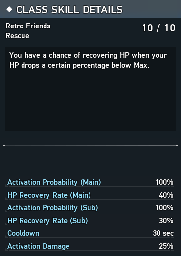{ align=right }

    When you take at least 25% of your maximum HP in damage, you have a 75% chance to recover 30% of your HP immediately after.
    It has a 30 second cooldown but is still nice to have because it can sometimes save you from death from multi-hit attacks.

    !!! tip
        The healing from this skill can trigger the "recover HP" condition of the EX Turnover [EX Augment](#ex-augments).
    

    

        <iframe width="560" height="315" src="https://www.youtube.com/embed/lPRezbotL0c?playlist=lPRezbotL0c&mute=1&loop=1" title="YouTube video player" frameborder="0" allow="accelerometer; autoplay; clipboard-write; encrypted-media; gyroscope; picture-in-picture; web-share" referrerpolicy="strict-origin-when-cross-origin" allowfullscreen></iframe>
    

=== "{ .twemoji } Welfare Management"

    

    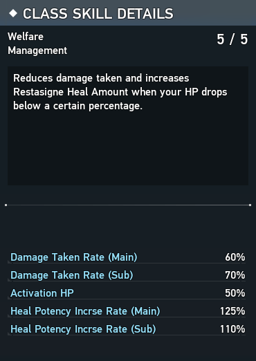{ align=right }

    When below 50% HP, damage taken is reduced by 40% and Restasigne heal amount is increased by 25%.

    This skill has great synergy with the [EX Augment](#ex-augments) combination of EX Maintain Balance and EX Shortage HP Starling, which keep your HP below 50% while also increasing potency by 1.5% and reducing damage taken by another 30% when below 50% HP.
    

    

        <iframe width="560" height="315" src="https://www.youtube.com/embed/w_3t9DfqcOU?playlist=w_3t9DfqcOU&mute=1&loop=1" title="YouTube video player" frameborder="0" allow="accelerometer; autoplay; clipboard-write; encrypted-media; gyroscope; picture-in-picture; web-share" referrerpolicy="strict-origin-when-cross-origin" allowfullscreen></iframe>
    

=== "{ .twemoji } Resta Effect Continuance"

    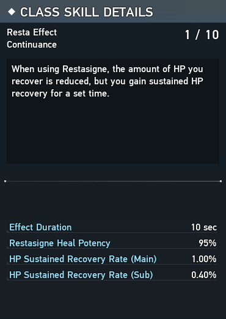{ align=right }

    Trades away instant Restasigne HP restoration to add a healing over time effect that makes Restasignes heal an overall greater amount of HP.

    !!! tip
        The healing from this skill can trigger the "recover HP" condition of the EX Turnover [EX Augment](#ex-augments).

=== "{ .twemoji } Lucky Sign"

    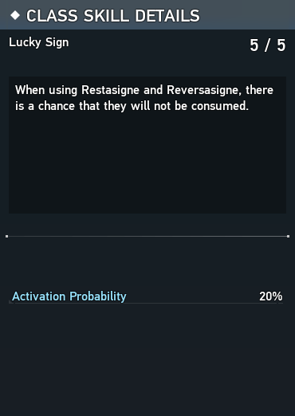{ align=right }

    A 20% chance to not a consume Restasigne when you use one.

